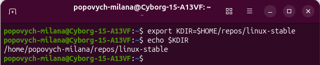
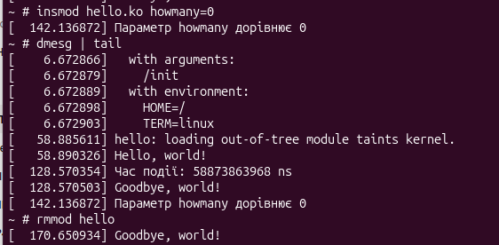
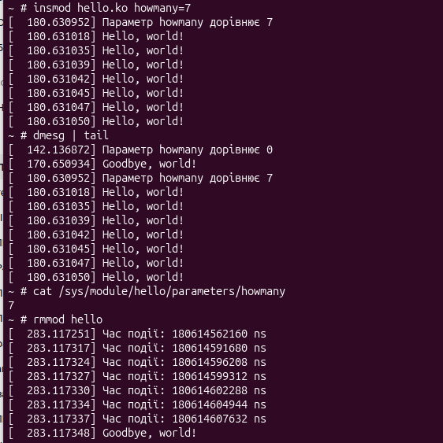
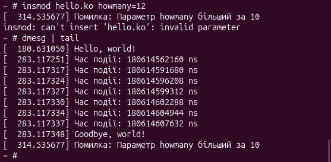

# Лабораторна робота № 4 ІО-46 Попович Мілана
## Тема: 
Розроблення модулів Linux Kernel (частина 1)
## Завдання: 
Створити модуль ядра, який динамічно завантажується та вивантажується в систему, та додати параметр типу `uint` до виконуваного файлу. 
Реалізувати роботу зі списком і пам'яттю. 

---
## Розділи

[Виконання завдання](https://github.com/MilanaPopovych/AK-2_Labwork/blob/main/lab4/README.md#%D0%B2%D0%B8%D0%BA%D0%BE%D0%BD%D0%B0%D0%BD%D0%BD%D1%8F-%D0%B7%D0%B0%D0%B2%D0%B4%D0%B0%D0%BD%D0%BD%D1%8F) \
[Результати тестування](https://github.com/MilanaPopovych/AK-2_Labwork/blob/main/lab4/README.md#%D1%80%D0%B5%D0%B7%D1%83%D0%BB%D1%8C%D1%82%D0%B0%D1%82%D0%B8-%D0%BF%D0%B5%D1%80%D0%B5%D0%B2%D1%96%D1%80%D0%BA%D0%B8-%D1%80%D0%BE%D0%B1%D0%BE%D1%82%D0%B8-%D0%BC%D0%BE%D0%B4%D1%83%D0%BB%D1%8F-%D0%B2-%D1%81%D0%B5%D1%80%D0%B5%D0%B4%D0%BE%D0%B2%D0%B8%D1%89%D1%96-qemu)

---
## Хід роботи

**Підготовка до завдання**

Перед виконанням make, до команд export, які використовувалися для
збирання ядра, додаємо export KDIR=шлях_до_каталогу_ядра
(наприклад, $HOME/repos/linux-stable)
```sh
$ export KDIR=$HOME/repos/linux/stable
```
Перевіряємо встановлення шляхів за допомогою `echo`

Результат виконання команди: \


Для розробки та тестування модуля ядра в середовищі QEMU було використано робочий каталог test2 з конфігураційними файлами Kbuild, Makefile. 

### Виконання завдання

__*1. Реалізація вихідного файлу*__ \
Цей етап передбачає модифікацію вихідного файлу *hello.c* з дотриманням обмежень та архітектурних вимог середовища ядра Linux. \
Кожен модуль повинен містити інформаційні макроси (автор, опис та ліцензія):
```c
MODULE_AUTHOR("Serhii Popovych <serhii.popovych@globallogic.com>");
MODULE_DESCRIPTION("Hello, world in Linux Kernel Training");
MODULE_LICENSE("Dual BSD/GPL");
```
Визначення функцій, які виконуються безпосередньо в момент завантаження модуля (`insmod`) та його видалення (`rmmod`):
1. Функція ініціалізації `__init` викликається першочергово та повертає 0 або від'ємний код помилки;
2. Функція виходу `__exit` відповідає за очищення пам'яті та видалення ресурсів
3. Макроси `module_init()`, `module_exit()` зв'язують функції з механізмом керування модулями ядра:
```c
module_init(hello_init);
module_exit(hello_exit);
```

__*2. Параметризація*__ \
Необхідно додати цілочисельний параметр howmany, за допомогою якого реалізувати перевірку вхідних значень:
* якщо значення перевищує 10, модуль не повинен завантажуватися (повернення коду помилки -EINVAL);
* для нульових або специфічних значень генерувати попередження через printk(KERN_WARNING).
Фрагмент коду (перевірка всередині функції `__init`):
```c
/*Якщо знач. більше 10 -- друкуємо помилку і повертаємо -EINVAL */
	if (howmany > 10) {
		printk(KERN_ERR "Помилка: Параметр howmany більший за 10\n");
		return -EINVAL;	
	}
	/* Якщо знач. 0 або між 5 і 10 -- попередження і вивід */
	if (howmany == 0 || (howmany >= 5 && howmany <= 10)) {
		printk(KERN_WARNING "Параметр howmany дорівнює %u\n", howmany);
	}
```

__*3. Зв'язані списки та пам'ять*__ \
Під час кожної ітерації виведення повідомлення виділяти пам'ять у ядрі за допомогою `kmalloc`, отримувати поточну мітку часу ядра (`ktime_get`) та додавати елемент до двонаправленого списку (`struct list_head`).
Фрагмент коду:
```c
ptr = kmalloc(sizeof(*ptr), GFP_KERNEL);
		/* Перевірка виділення пам'яті */
		if (!ptr) {
			printk(KERN_ERR "Помилка! Не вдалося виділити пам'ять\n");
			struct hello_time_node *md, *tmp;
			list_for_each_entry_safe(md, tmp, &hello_list_head, list) {
			list_del(&md->list);
			kfree(md);
			}
			return -ENOMEM;
		}
		/* Заносимо поточний час ядра у відповідне поле */
		ptr->time = ktime_get(); 
		list_add_tail(&ptr->list, &hello_list_head);
		printk(KERN_INFO "Hello, world!\n");
	}
```

__*4. Очищення ресурсів*__ \
Під час вивантаження модуля (`rmmod`) або в разі помилки виділення пам'яті реалізувати безпечний обхід списку (`list_for_each_entry_safe`), виведення збережених часових міток у наносекундах та коректне звільнення пам'яті за допомогою `kfree`, щоб уникнути витоків.
Фрагмент коду:
```c
static void __exit hello_exit(void){
	/* Вказівники для поточного ел-та та тимчасового */
	struct hello_time_node *md, *tmp;
	/* Прохід по списку з безпечним вилученням ел-тів */
	list_for_each_entry_safe(md, tmp, &hello_list_head, list) {
		/* Час події в наносек. */
		printk(KERN_INFO "Час події: %lld ns\n", ktime_to_ns(md->time));
		/* Вилучення ел-та зі списку */
		list_del(&md->list);
		/* Звільнення пам'яті */
		kfree(md);
	}
	printk(KERN_INFO "Goodbye, world!\n");
}
```
__*5. Збирання*__ \
На цьому етапі необхідно налаштувати систему збирання за допомогою Kbuild та Makefile для крос-компіляції модуля під цільову архітектуру (ARM) та перевірити його роботу в середовищі віртуалізації (QEMU).
Вміст файлу *Makefile*: 
```c
# normal makefile
ARCH ?= arm
CROSS_COMPILE ?= arm-linux-gnueabihf-

KDIR ?= /home/popovych-milana/repos/linux-stable

default:
	$(MAKE) -C $(KDIR) M=$$PWD ARCH=$(ARCH) CROSS_COMPILE=$(CROSS_COMPILE) modules
clean:
	$(MAKE) -C $(KDIR) M=$$PWD ARCH=$(ARCH) CROSS_COMPILE=$(CROSS_COMPILE) clean
```
Вміст файлу *Kbuild*:
```c
# kbuild part of makefile
obj-m := hello.o
```

### Результати перевірки роботи модуля в середовищі QEMU

1. Тестування з нульовим параметром howmany (попередження KERN_WARNING)



2. Тестування з певним придатним значенням параметру howmany з перевіркою значення параметра в файловій системі sysfs та часових міток



3. Тестування з певним недопустимим значенням параметру howmany (KERN_ERR) та перевіркою часових міток



---

## Висновок
В ході лабораторної роботи було успішно розроблено, скомпільовано та протестовано динамічний модуль ядра Linux. 
Закріплено навички роботи з параметрами ядра, їх перевірки та обробкою непридатних значень із поверненням відповідних кодів помилок.
Практично реалізовано динамічне управління пам'яттю у просторі ядра за допомогою функцій kmalloc та kfree, 
відпрацьовано процес крос-компіляції модулів ядра за допомогою системи збирання Kbuild/Makefile та їх перевірки 
увімкнення/вивантаження (insmod/rmmod) у віртуальному середовищі QEMU.
