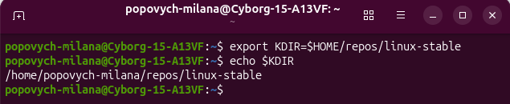
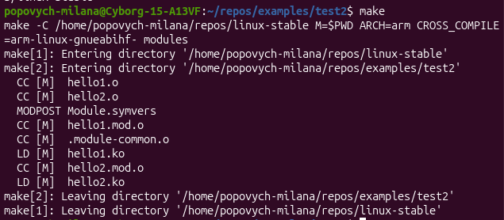
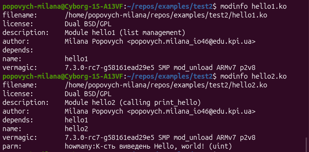
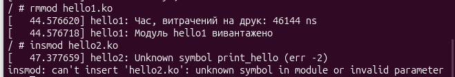
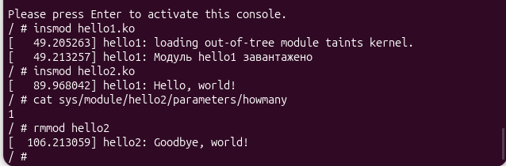
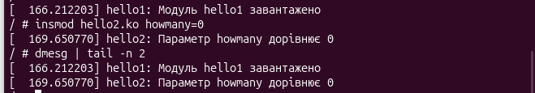
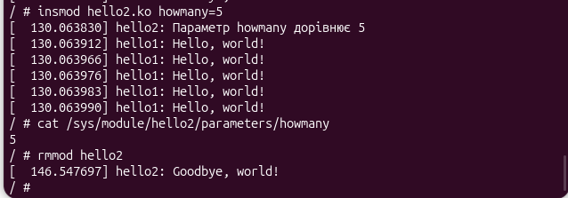
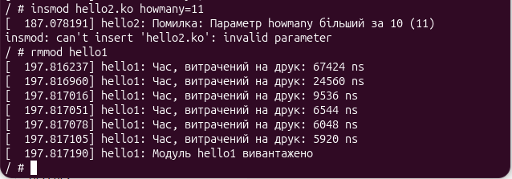

# Лабораторна робота № 5 ІО-46 Попович Мілана
## Тема: 
Розроблення модулів Linux Kernel (частина 2)
## Завдання: 
Розділити попередній модуль ядра на два взаємопов'язані (hello1 і hello2) та перевірити їхню роботу за різних значень параметра в середовищі QEMU. 

---
## Розділи

[Виконання завдання](https://github.com/MilanaPopovych/AK-2_Labwork/blob/main/lab5/README.md#%D0%B2%D0%B8%D0%BA%D0%BE%D0%BD%D0%B0%D0%BD%D0%BD%D1%8F-%D0%B7%D0%B0%D0%B2%D0%B4%D0%B0%D0%BD%D0%BD%D1%8F) \
[Результати тестування](https://github.com/MilanaPopovych/AK-2_Labwork/blob/main/lab5/README.md#%D1%80%D0%B5%D0%B7%D1%83%D0%BB%D1%8C%D1%82%D0%B0%D1%82%D0%B8-%D0%BF%D0%B5%D1%80%D0%B5%D0%B2%D1%96%D1%80%D0%BA%D0%B8-%D1%80%D0%BE%D0%B1%D0%BE%D1%82%D0%B8-%D0%BC%D0%BE%D0%B4%D1%83%D0%BB%D1%8F-%D0%B2-%D1%81%D0%B5%D1%80%D0%B5%D0%B4%D0%BE%D0%B2%D0%B8%D1%89%D1%96-qemu)

---
## Хід роботи

**Підготовка до завдання**

Перед виконанням make, до команд export, які використовувалися для
збирання ядра, додаємо export KDIR=шлях_до_каталогу_ядра
(наприклад, $HOME/repos/linux-stable)
```sh
$ export KDIR=$HOME/repos/linux/stable
```
Перевіряємо встановлення шляхів за допомогою `echo`

Результат виконання команди: \


Для розробки та тестування модуля ядра в середовищі QEMU було використано робочий каталог test2 з конфігураційними файлами Kbuild, Makefile. 

### Виконання завдання

__*1. Поділ вихідного коду на модулі ядра*__ \
Цей етап передбачає розробку файлів модулів ядра *hello1.c* та *hello2.c* з дотриманням обмежень та архітектурних вимог середовища ядра Linux. \
Кожен модуль повинен містити інформаційні макроси (автор, опис та ліцензія):
```c
// Модуль hello1
MODULE_AUTHOR("Milana Popovych <popovych.milana_io46@edu.kpi.ua>");
MODULE_DESCRIPTION("Module hello1 (list management)");
MODULE_LICENSE("Dual BSD/GPL");
```

```c
// Модуль hello2
MODULE_AUTHOR("Milana Popovych <popovych.milana_io46@edu.kpi.ua>");
MODULE_DESCRIPTION("Module hello2 (calling print_hello)");
MODULE_LICENSE("Dual BSD/GPL");
```
Також реалізовано заголовковий файл спільного інтерфейсу *hello.h*, що містить оголошення (прототип) функції `int print_hello(void)`, що
викликається модулем hello2: 

```c
/* SPDX-License-Identifier: Dual BSD/GPL */
#ifndef HELLO1_H
#define HELLO1_H

int print_hello(void);

#endif 
```

__*2. Структура модулів ядра*__ 

***hello1.c:***
 - Експортована функція `int print_hello(void)` для керування елементами двозв'язного списку та збереження часових міток до та після виведення повідомлення "Hello, world!"
 - Функція ініціалізації модуля ядра `static int __init hello1_init(void)`, яка виконується під час його завантаження (`insmod`) та виводить інформаційне повідомлення в буфер ядра.
 - Функція деініціалізації `static void __exit hello1_exit(void)`, яка викликається під час вивантаження модуля (`rmmod`)

```c
// SPDX-License-Identifier: Dual BSD/GPL
#define pr_fmt(fmt) KBUILD_MODNAME ": " fmt
#include <linux/init.h>
#include <linux/module.h>
#include <linux/printk.h>
#include <linux/list.h>
#include <linux/ktime.h>
#include <linux/slab.h>
#include "hello1.h"

MODULE_AUTHOR("Milana Popovych <popovych.milana_io46@edu.kpi.ua>");
MODULE_DESCRIPTION("Module hello1 (list management)");
MODULE_LICENSE("Dual BSD/GPL");

struct hello_time_node {
	struct list_head list;
	ktime_t time_before;
	ktime_t time_after;
};

/* Статична змінна голови списку  */
static LIST_HEAD(hello_list_head);

int print_hello(void) {
	struct hello_time_node *ptr;
        
	ptr = kmalloc(sizeof(*ptr), GFP_KERNEL);
	if (!ptr) {
		pr_err("Помилка виділення пам'яті\n");
		return -ENOMEM;
	}
	/* Час до виведення повідомлення*/
	ptr->time_before = ktime_get();
	pr_info("Hello, world!\n");
	/* Час після виведення повідомлення*/
	ptr->time_after = ktime_get();
	/* Додавання створеного ел-та в кінець списку */
	list_add_tail(&ptr->list, &hello_list_head);
	return 0;
}
EXPORT_SYMBOL(print_hello);

static int __init hello1_init(void)
{
        /* Інформаційне повідомлення під час завантаження модуля */
	pr_info("Модуль hello1 завантажено\n");
	return 0;
}

static void __exit hello1_exit(void){
	struct hello_time_node *md, *tmp;
	ktime_t delta;
	list_for_each_entry_safe(md, tmp, &hello_list_head, list) {
	/* Обчислення часу кожного виклику друку (в нс) */
		delta = ktime_sub(md->time_after, md->time_before);
		pr_info("Час, витрачений на друк: %lld ns\n", ktime_to_ns(delta));
		/* Видалення вузла зі списку*/
		list_del(&md->list);
		/* Звільнення пам'яті */
		kfree(md);
	}
	pr_info("Модуль hello1 вивантажено\n");
}
module_init(hello1_init);
module_exit(hello1_exit);
```

***hello2.c:***
  - Точка входу при завантаженні модуля `static int __init hello2_init(void)`;
  перевіряє значення параметра `howmany` та відповідно до ситуації виводить повідомлення через макроси `pr_*`.
  - Функція вивантаження модуля `static void __exit hello2_exit(void)`, яка записує завершальне повідомлення `pr_info("Goodbye, world!\n");`

```c
// SPDX-License-Identifier: Dual BSD/GPL
#define pr_fmt(fmt) KBUILD_MODNAME ": " fmt
#include <linux/init.h>
#include <linux/module.h>
#include <linux/printk.h>
#include <linux/moduleparam.h>
#include <linux/errno.h>
#include "hello1.h"


MODULE_AUTHOR("Milana Popovych <popovych.milana_io46@edu.kpi.ua>");
MODULE_DESCRIPTION("Module hello2 (calling print_hello)");
MODULE_LICENSE("Dual BSD/GPL");

static uint howmany = 1;
module_param(howmany, uint, 0444);
MODULE_PARM_DESC(howmany, "К-сть виведень Hello, world!");

static int __init hello2_init(void)
{
	uint i;
	int ret;

	if (howmany > 10) {
		pr_err("Помилка: Параметр howmany більший за 10 (%u)\n", howmany);
		return -EINVAL;
	}
	if (howmany == 0 || (howmany >= 5 && howmany <= 10)) {
		pr_warn("Параметр howmany дорівнює %u\n", howmany);
	}
	for (i = 0; i < howmany; i++) {
		ret = print_hello();
		if (ret) {
			pr_err("Помилка виклику print_hello() на ітерації %u\n", i);
			return ret;
		}
	}
	return 0;
}

static void __exit hello2_exit(void)
{
	pr_info("Goodbye, world!\n");
}

module_init(hello2_init);
module_exit(hello2_exit);
```

__*3. Налаштування системи збирання*__ \
На цьому етапі необхідно налаштувати систему збирання за допомогою Kbuild та Makefile для крос-компіляції модуля під цільову архітектуру (ARM) та перевірити його роботу в середовищі віртуалізації (QEMU).

Kbuild:
```c
# kbuild part of makefile
ccflags-y := -I$(src)/inc
obj-m := hello1.o hello2.o
```
Makefile:
```c
# normal makefile
ARCH ?= arm
CROSS_COMPILE ?= arm-linux-gnueabihf-

KDIR ?= /home/popovych-milana/repos/linux-stable

default:
	$(MAKE) -C $(KDIR) M=$$PWD ARCH=$(ARCH) CROSS_COMPILE=$(CROSS_COMPILE) modules
clean:
	$(MAKE) -C $(KDIR) M=$$PWD ARCH=$(ARCH) CROSS_COMPILE=$(CROSS_COMPILE) clean
```

__*4. Крос-компіляція, перевірка метаданих модулів*__ \
Цей етап складається з демонстрації результатів збірки модулів ядра командою `make` (в результаті чого створено файли об'єктів ядра: *hello1.ko*, *hello2.ko* та файл таблиці символів *Module.symvers*) та перевірки інформації про скомпільовані модулі (утиліта `modinfo`):




### Результати перевірки роботи модуля в середовищі QEMU

Перевірка залежностей між модулями:



Тестування значень параметра howmany:

1. Тестування з базовим значенням (1) параметра (завантаження модулів ядра):



2. Тестування з нульовим параметром howmany (попередження pr_warn без виклику print_hello())



3. Тестування з певним придатним значенням параметру howmany з перевіркою значення параметра в файловій системі sysfs та часових міток



4. Тестування з певним недопустимим значенням параметру howmany (pr_err) та перевіркою часових міток



---

## Висновок
В ході лабораторної роботи було розроблено та протестовано два взаємопов'язані модулі ядра Linux (hello1 та hello2) із винесенням спільного інтерфейсу в окремий заголовковий 
файл hello1.h, заміною викликів printk на макроси pr_info, pr_warn і pr_err, а також вимірюванням часу виконання операцій друку в наносекундах за допомогою інтерфейсу ktime_t 
та двозв'язних списків ядра. \
У середовищі QEMU/BusyBox перевірено роботу модулів за різних значень параметра howmany (граничних і помилкових) та підтверджено 
залежність модуля hello2 від експортованого символу print_hello() модуля hello1. Закріплено навички проєктування багатомодульної архітектури в просторі ядра, 
налаштування системи збирання Kbuild, експорту символів між модулями (EXPORT_SYMBOL), 
крос-компіляції під архітектуру ARM та налагодження модулів за допомогою утиліт командного рядка Linux.
